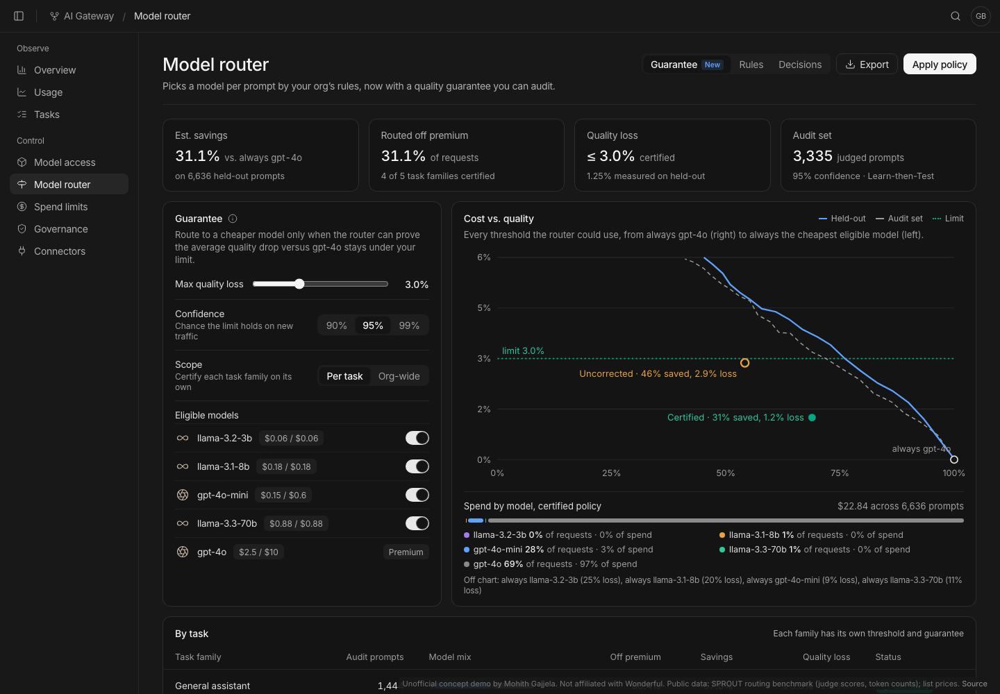

# Router guarantee for the Wonderful AI Gateway

**Live demo:** https://mohith26.github.io/wonderful-router-guarantee/ (unofficial concept, public data)

The Wonderful AI Gateway's model router "picks the most cost-effective model that can complete [a request] without losing quality". Today that promise rests on how the router was tuned. **Router guarantee** turns it into a number an enterprise can audit: you set the most quality you are willing to lose versus the premium model (for example 3 judge-score points) and a confidence (95%), and the router only routes away from the premium model where a small judged audit set *proves* the limit holds, per task family. On 6,636 held-out prompts from the public SPROUT routing benchmark it cut cost **31.1%** versus always using gpt-4o, with a certified 3% limit and **1.25%** measured loss. Tuning the same router without the correction broke the limit in **39%** of random re-splits per task family; the certified version in **0.3%**.



## What it adds to the product

- A **Guarantee** tab on Model router: max quality loss slider, confidence (90/95/99%), scope (per task family or org-wide), eligible models (only approved models are ever considered, like Model access).
- KPI cards (savings, share routed off premium, certified limit vs. measured loss, audit-set size) and a **cost vs. quality** chart of every threshold the router could use, with the certified and the uncorrected settings marked, plus spend by model under the certified policy.
- **By task** table with per-family thresholds, model mix, savings and status; click a family for the risk-by-threshold chart (audit-set loss and its upper bound), the uncorrected setting's held-out loss, a live re-split validity check, how many judged prompts it would take to certify the uncorrected setting, and sample routing decisions.
- **Decisions** tab (sample prompts, which model each one goes to under the current settings, the router score, judge scores vs. gpt-4o, cost) and a **Rules** tab summarizing the active policy.
- **Apply policy** (versioned, saved in the browser, shown in the top bar), export of the policy JSON and per-task CSV, deep links (`#/model-router?eps=3&conf=95&task=0`), keyboard shortcuts (`1`-`3`, `[`/`]`, `j`/`k`, `a`, `e`, `?`).

## How it works (`src/guarantee.js`)

1. **Router score.** For each cheaper model, the router has a score for "this model will be as good as the premium model on this prompt". Here it is a logistic regression on hashed prompt words, task family, sub-task and length (`scripts/build_data.py`), standing in for the production router's own score. The guarantee works with any score; a better router just certifies more savings.
2. **Policy family.** For a threshold λ, send each prompt to the cheapest eligible model whose score is at least λ, otherwise to the premium model. λ above 1 is "always premium".
3. **Loss.** Per prompt, the drop in judge score versus the premium model, `max(0, score_premium − score_routed)`, in [0, 1].
4. **Learn-then-Test** (Angelopoulos, Bates, Candès, Jordan, Lei, 2021). On the judged audit set, for λ from strictest to loosest, compute the Hoeffding-Bentkus p-value for "risk(λ) > ε" and keep going while p ≤ δ (fixed-sequence testing, so no multiple-testing penalty). The loosest accepted λ satisfies P(risk(λ̂) ≤ ε) ≥ 1 − δ for new traffic from the same distribution. Per-task scope runs this separately for each family, so each family gets its own guarantee.
5. **Uncorrected baseline.** The loosest λ whose audit-set loss is at most ε, with no correction, which is how a dashboard threshold is usually tuned.
6. **Planner.** The number of judged prompts needed before a given audit-set loss would certify (binary search on the HB p-value).

## Results

From `results/results.json` (`node scripts/report.mjs`); a unit test recomputes the headline numbers from the data.

**Held-out (6,636 prompts), limit 3% quality loss, 95% confidence:**

| Policy | Cost saved vs. always gpt-4o | Off premium | Quality loss |
|---|---|---|---|
| Certified, per task family | **31.1%** | 31.2% | **1.25%** (certified ≤ 3%) |
| Certified, one org-wide threshold | 20.3% | 21.2% | 2.62% (certified ≤ 3%) |
| Always gpt-4o-mini | 93.2% | 100% | 8.5% |
| Always llama-3.3-70b | 89.2% | 100% | 10.6% |

**Does the guarantee hold?** 200 random re-splits of audit + held-out prompts; how often the held-out loss exceeded 3%:

| Family | Uncorrected tuning | Certified |
|---|---|---|
| General assistant | 48.5% | 0.5% |
| Knowledge Q&A | 39.0% | 0.5% |
| Math | 38.5% | 0.5% |
| Multi-step reasoning | 19.0% | 0% |
| Document Q&A (RAG) | 49.5% | 0% |
| Org-wide | 15.5% | 1.0% |

**Per family (certified, held-out):** General assistant 57.6% saved (2.13% loss), Math 22.2% (1.29%), Knowledge Q&A and Document Q&A stay almost entirely on gpt-4o, Multi-step reasoning stays on gpt-4o (47 audit prompts is too few).

## Honest limitations

- **Public benchmark data, older models.** SPROUT has judge scores and token counts for 13 models on general-assistant (OpenHermes), knowledge (MMLU-Pro, GPQA), math, reasoning (MuSR) and document QA (RAGBench) prompts. I kept 5 models (llama-3.2-3b, llama-3.1-8b, gpt-4o-mini, llama-3.3-70b, gpt-4o as premium). Prices are public list prices (OpenAI, Together AI); real contracts differ. 4 of 13,273 rows were skipped because the Hugging Face rows API failed on them.
- **The router score is weak** (calibration AUC 0.55-0.78). A production router would certify more savings; the guarantee layer is the contribution, not the router.
- **The guarantee is distributional.** It holds for traffic like the audit set (exchangeable). If the task mix, prompts or models drift, re-certify with a fresh audit set; a continuous version would use an anytime-valid test.
- **"Quality" is the benchmark's LLM judge score**, and the guarantee is on average loss versus the premium model, not on every prompt or on tail risk.
- Multi-step reasoning has 47 audit prompts, so it stays on the premium model; the planner says how many more judged prompts it would need.

## Prior art and what is new

- **Routers:** RouteLLM (Ong et al. 2024), FrugalGPT cascades (Chen et al. 2023), RouterBench (Hu et al. 2024), CARROT/SPROUT (Somerstep et al. 2025), and commercial routers (Martian, Not Diamond, OpenRouter auto) optimize cost/quality trade-offs but report average benchmark results, not a certified bound for a customer's own traffic.
- **Risk control:** Learn-then-Test and conformal risk control (Angelopoulos et al. 2021, 2022) are general; there is research on conformal cascades. I could not find a gateway or router product that lets an enterprise set a quality-loss limit and certifies it per task family from its own judged audit set. Wonderful's own Gateway launch (Oct 19, 2026) describes routing "without losing quality" with no stated guarantee.

## Run it

```bash
node --test test/guarantee.test.mjs          # 13 tests (HB validity, LTT vs plug-in, headline numbers, ...)
python3 scripts/fetch_sprout.py /tmp/sprout_compact.jsonl   # optional: re-fetch public data (~5 min)
python3 scripts/build_data.py /tmp/sprout_compact.jsonl     # data/router.json
node scripts/report.mjs                      # results/results.json
python3 -m http.server 8000                  # open http://localhost:8000
```

No build step or dependencies; Inter from Google Fonts, Lucide icons from unpkg.

Unofficial concept demo by Mohith Gajjela. Not affiliated with Wonderful.
